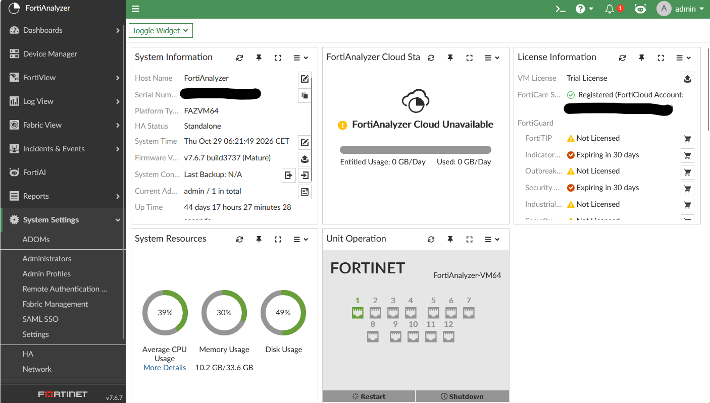
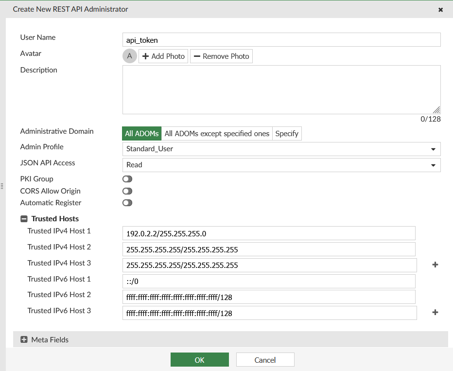
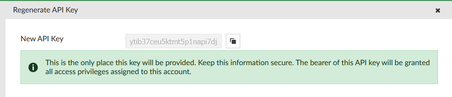

# PowerFAZ

This is a Powershell module for manage a FortiAnalyzer (Fortinet) Analyzer.

With this module (version 1.0.0) you can manage:

- [dvmdb](#dvmdb) (Get Adom and device from dvmdb)
- [Logview](#ogview) (Add logview search and get results)

There is some extra feature
- [Invoke API](#invoke-api)
- [ADOM](#ADOM)
- [Multi Connection](#multiconnection)

More functionality will be added later.

Tested with FortiAnalyzer (using 7.x and 8.x)

# Requirements

- Powershell 5 or 6.x/7.x (Core) (If possible get the latest version)
- A Fortinet FortiAnalyzer and HTTPS enable with JSON API enable for the user

# Instructions
### Install the module
```powershell
# Automated installation (Powershell 5 or later):
    Install-Module PowerFAZ

# Import the module
    Import-Module PowerFAZ

# Get commands in the module
    Get-Command -Module PowerFAZ

# Get help
    Get-Help Get-FAZDvmdbAdom -Full
```

# Examples
### Connecting to the FortiAnalyzer

#### Create a REST API Admin Token (recommended)
The first thing to do is to create a REST API Admin token

Go on WebGUI of your FortiAnalyzer, on System Settings  
  

Go `Administrators`  
  

Click on `Create New` => `REST API Admin`   

  
and create a new user and don't forget to enable `JSON API Access` to `Read` (or `Read-Write`), set `Admin_Profile` on `Standard User`
and also to set `Trusted IPv4 Host` to host or network where you plan to use PowerFAZ

Click on `OK`

  

You get the generate token (copy on secure place)

```powershell
# Connect to the FortiAnalyzer
    Connect-FAZ 192.0.2.1 -apitoken ytib37ceu5ktmt5p1napi7djwagyxjs5

```
if you get a warning about `Unable to connect` Look [Issue](#issue)

#### Create (or Modify) an user with API JSON Access
You can also create (or modify)an user with API (JSON) Access  

Go on WebGUI of your FortiAnalyzer, on System Settings  
  

Go `Administrators`  
  

Click on `Create New` => `Administrator`   

  
and create a new user and don't forget to enable `JSON API Access` to `Read` (or `Read-Write`) and set `Admin_Profile` on `Standard User`

After connect to a FortiAnalyzer with the command `Connect-FAZ` :

```powershell
# Connect to the FortiAnalyzer
    Connect-FAZ 192.0.2.1

#we get a prompt for credential
    Please enter administrative credential for your FortiAnalyzer
    User: api
    Password for user api: *****************

```
if you get a warning about `Unable to connect` Look [Issue](#issue)

### dvmdb

You can get info about Adom `Get-FAZDvmdbAdom` and Device `Get-FAZDvmdbDevice` via dvmdb

```powershell
# get name of all adom
    Get-FAZDvmdbAdom | select name

    name
    ----
    FortiAnalyzer
    FortiAuthenticator
    FortiCache
    FortiCarrier
    FortiClient
    FortiDDoS
    FortiDeceptor
    FortiFirewall
    FortiFirewallCarrier
    FortiMail
    FortiManager
    FortiProxy
    FortiSandbox
    FortiWeb
    Syslog
    Unmanaged_Devices
    others
    root

# get device of all adom

    Get-FAZDvmdbDevice

    adm_pass             : {ENC, SH2VC3qKiB/9sQpNGmBhsRVz/YB6wm1SG1z/7/mfvlc+0D0mzeI0zw44JM5PxA=}
    adm_usr              :
    app_ver              :
    auto_mgmt            :
    av_ver               :
    beta                 : -1
    branch_pt            : 2902
    build                : 2902
    checksum             :
    cluster_worker       : {}
    conf_status          : unknown
    conn_mode            : active
    conn_status          : UNKNOWN
    [..]
    ip                   : 10.0.255.1
    [...]
    name                 : XXXXXXXX-HA_FG120G
    [...]
    platform_str         : FortiGate-120G
    [...]
    sn                   : FG120GTK2600XXXX
    [...]

```
### Invoke API
for example to get FortiAnalyzer System Status Info

```powershell
# get FortiAnalyzer System Status using API

    Invoke-FAZRestMethod -method "get" sys/status

    Admin Domain Configuration  : Disabled
    BIOS version                : 04000002
    Branch Point                : 3737
    Build                       : 3737
    Current Time                : Fri Oct 30 12:37:09 CET 2026
    Daylight Time Saving        : Yes
    Disk Usage                  : Free 241.50GB, Total 491.08GB
    FIPS Mode                   : Disabled
    Hostname                    : FortiAnalyzer
    License Status              : Valid
    Major                       : 7
    Max Number of Admin Domains : 2
    Minor                       : 6
    Patch                       : 7
    Platform Full Name          : FortiAnalyzer-VM64
    Platform Type               : FAZVM64
    Release Version Information :  (GA.M)
    Serial Number               : FAZ-VMTM21000000
    TZ                          : Europe/Brussels
    Time Zone                   : (GMT+1:00) Brussels, Copenhagen, Madrid, Paris.
    Version                     : v7.6.7-build3737 260601 (GA.M)
    x86-64 Applications         : Yes

```
You can look `FortiAnalyzer - JSON API (Full Reference)` available on [Fortinet Developer Network (FNDN)](https://fndn.fortinet.net/)

### ADOM

it is possible set ADOM when connect to FortiAnalyzer (by default it is on root adom)

For connect on the pester vdom 
```powershell
    Connect-FAZ 192.0.2.1 -adom pester
[...]
```
You can also change default adom using
```powershell
    Set-FAZConnection -adom vdomY
[...]
```

### MultiConnection

it is possible to connect on same times to multi FortiAnalyzer (or same Analyzer with different adom)
You need to use -connection parameter to cmdlet

For example to get adom of 2 FortiAnalyzer

```powershell
# Connect to first FortiAnalyzer
    $faz1 = Connect-FAZ 192.0.2.1 -SkipCertificateCheck -DefaultConnection:$false

#DefaultConnection set to false is not mandatory but only don't set the connection info on global variable

# Connect to second FortiAnalyzer
    $faz2 = Connect-FAZ 192.0.2.2 -SkipCertificateCheck -DefaultConnection:$false

# Get Device (dvmdb) for first FortiAnalyzer
    Get-FAZDvmdbDevice -connection $faz1 | select name, sn, platform_str, ip

    name               sn               platform_str   ip
    ----               --               ------------   --
    XXXXXXXX-HA_FG120G FG120GTK2600XXXX FortiGate-120G 10.0.255.1
[..]
....

# Get Device (dvmdb) for second FortiAnalyzer
    Get-FAZDvmdbDevice -connection $faz2 | select name, sn, platform_str, ip

    name               sn               platform_str   ip
    ----               --               ------------   --
    YYYYYYYY-HA_FG90G  FG90GTK2600YYYY FortiGate-90G 10.0.255.2
...

#Each cmdlet can use -connection parameter

```

### Disconnecting

```powershell
# Disconnect from the FortiAnalyzer
    Disconnect-FAZ
```

# Issue

## Unable to connect (certificate)

if you use `Connect-FAZ` and get `Unable to Connect (certificate)`

The issue coming from use Self-Signed or Expired Certificate for FortiAnalyzer  
Try to connect using `Connect-FAZ -SkipCertificateCheck`

# How to contribute

Contribution and feature requests are more than welcome. Please use the following methods:

  * For bugs and [issues](https://github.com/FortiPower/PowerFAZ/issues), please use the [issues](https://github.com/FortiPower/PowerFAZ/issues) register with details of the problem.
  * For Feature Requests, please use the [issues](https://github.com/FortiPower/PowerFAZ/issues) register with details of what's required.
  * For code contribution (bug fixes, or feature request), please request fork PowerFAZ, create a feature/fix branch, add tests if needed then submit a pull request.

# Contact

Currently, [@alagoutte](#author) started this project and will keep maintaining it. Reach out to me via [Social Network](#author), Email (see top of file) or the [issues](https://github.com/FortiPower/PowerFAZ/issues) Page here on GitHub. If you want to contribute, also get in touch with me.

# List of available command
```powershell
Add-FAZLogviewLogsearch
Connect-FAZ
Disconnect-FAZ
Get-FAZDvmdbAdom
Get-FAZDvmdbDevice
Get-FAZLogviewLogsearch
Get-FAZLogviewLogsearchCount
Invoke-FAZRestMethod
Set-FAZCipherSSL
Set-FAZConnection
Set-FAZUntrustedSSL
Show-FAZException
```

# Author

**Alexis La Goutte**
- <https://github.com/alagoutte>
- <https://bsky.app/profile/alagoutte.bsky.social>
- <https://twitter.com/alagoutte>
- <https://www.linkedin.com/in/alexis-lagoutte>

# Special Thanks

- Warren F. for his [blog post](http://ramblingcookiemonster.github.io/Building-A-PowerShell-Module/) 'Building a Powershell module'
- Erwan Quelin for help about Powershell

# License

Copyright 2026 Alexis La Goutte and the community.
